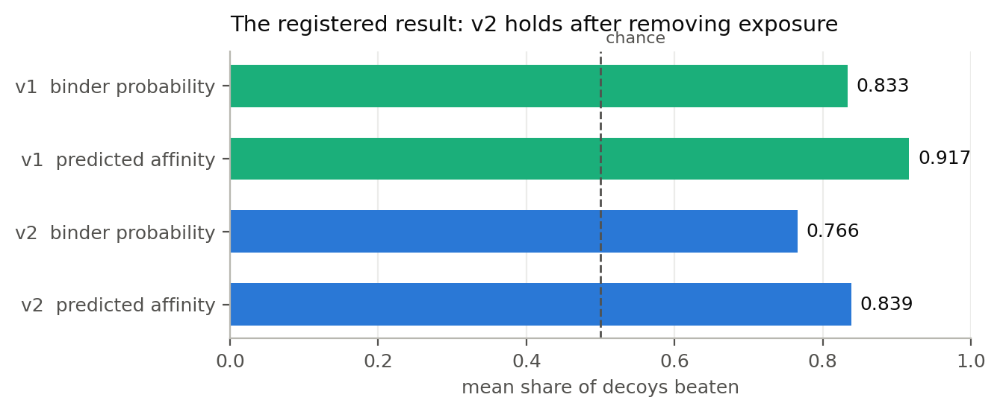
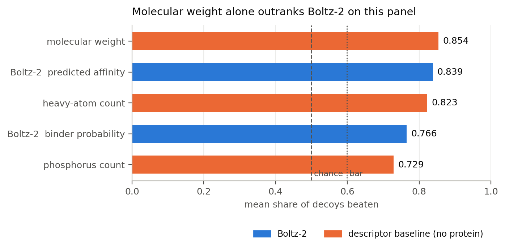
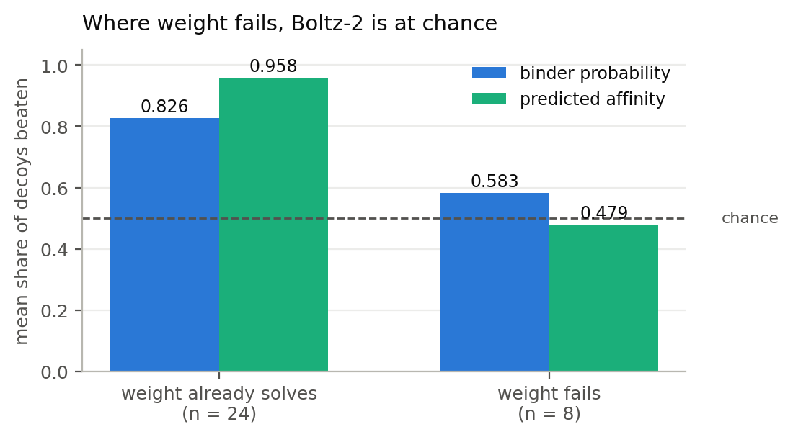
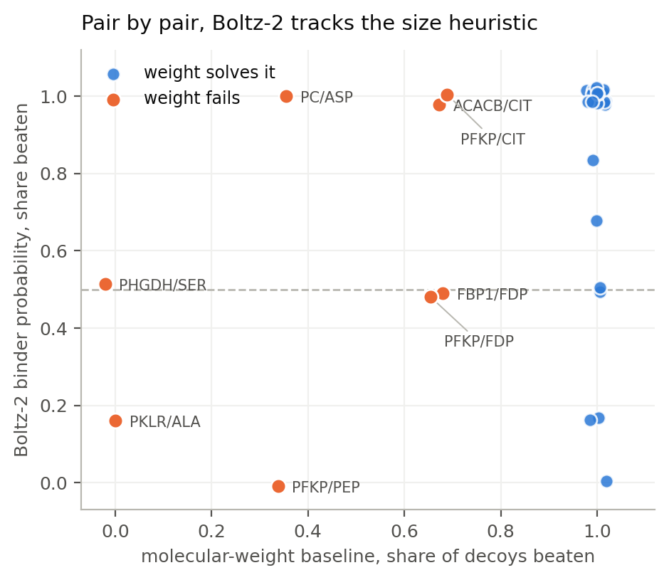
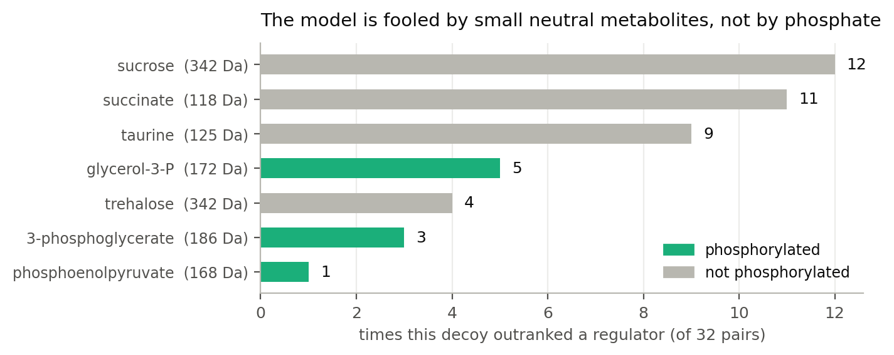
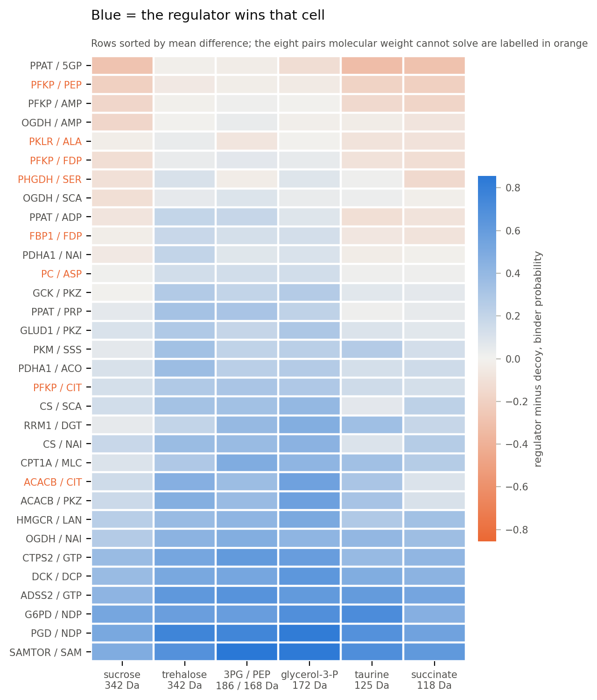
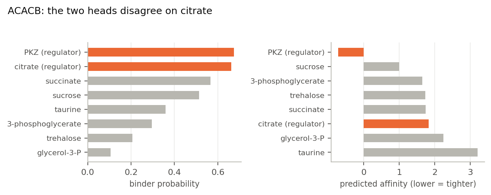

# Boltz-2 metabolite-regulator benchmark: the v2 result

Javier Villela-Castrejón · 6 November 2026 · pre-registered in PLAN_V2.md, hashed 28 October 2026 before selection

## Summary

The benchmark asks whether Boltz-2 ranks a human metabolic enzyme's known regulator above six decoys, and
whether it can do that for pairs it has not memorised. v2 answers both questions, and the two answers point
in opposite directions.

**The registered analysis is a clear positive.** Over 32 regulator pairs selected to have no co-structure in
the PDB and no deposited binding measurement in ChEMBL or BindingDB, the regulator beat 0.766 of its decoys
on binder probability and 0.839 on predicted affinity, against a chance bar of 0.599, with p below 1e-5 on both.

**A post-hoc baseline dissolves it.** Ranking the same seven molecules by molecular weight alone, with no
protein, no structure and no model, scores 0.854. Heavy-atom count scores 0.823. Both beat Boltz-2.

The decomposition says why. On the 24 pairs where weight already puts the regulator first, Boltz-2 scores
0.826. On the 8 pairs where weight fails, it scores 0.583 on binder probability (p = 0.27) and 0.479 on
predicted affinity, at or below chance.

The honest reading is that on this panel Boltz-2 does not demonstrably beat a size heuristic, and
the subset where it could add something is too small to resolve. The registered result stands exactly as
registered. What fails is the inference from it: the uniform-rank null the statistic was tested against holds
chance constant while letting molecular size vary, so it is the wrong null for the scientific claim.

## What was run

PLAN_V2.md was hashed on 28 October, before any pair was selected, because which pairs enter the panel is the
largest researcher degree of freedom in this design and the one most able to manufacture either result.

A pair entered only if all four held: the regulation is established by kinetics, mutagenesis or equivalent
biochemistry in at least one peer-reviewed paper; the PDB holds no structure of the enzyme, or a homolog above
95% identity, in complex with the metabolite at any date; neither ChEMBL nor BindingDB holds a binding or
inhibition measurement for the pair; and the enzyme is human. The third test is the one a purely temporal
split cannot give, and it is why the panel is selected this way rather than by date: Boltz-2 discloses a
structural training cutoff of 2023-06-01 but no affinity-data cutoff, so a temporal design would control the
structure module and leave the affinity module, the secondary metric here, entirely uncontrolled.

The rule yielded **32 regulator pairs across 22 enzymes**, six decoys per enzyme (two phosphorylated
non-nucleotides, two size-matched neutral sugars, two small metabolites), 164 complexes in all. The plan's
stopping rule was 8 pairs. The panel came in at four times that, and nearly three times v1's 12.

Phase 1 (156 complexes) ran 31 October to 2 November. Phase 2, the eight ACACB complexes at 2,458 residues,
ran solo 2 to 6 November. Zero failures, and the artefacts were verified rather than the log: 164 affinity
files and 164 confidence files present. Total 152.55 hours, 6.356 days, inside the registered 5.5 to 6.5 day
band, entirely on CPU with no GPU.

The three registered analysis scripts were written and hashed into V2_ANALYSIS.sha256 before any was executed
and before any v2 output was read. The descriptor baseline in this report was written afterwards, and is
labelled post-hoc wherever it appears.

## The registered result

| | v1 (12 pairs, mostly in training) | v2 (32 pairs, no exposure) | bar |
|---|---|---|---|
| binder probability | 0.833 (p 0.00024) | **0.766** (p < 1e-5) | 0.599 |
| predicted affinity | 0.917 (p < 1e-5) | **0.839** (p < 1e-5) | 0.599 |

*Figure 1. The registered result. Mean share of decoys beaten in v1 and v2 on both metrics. Removing
structural and binding-data exposure costs about 0.07 and leaves both well clear of the 0.599 bar.*

Both v2 p values came back as 0 of 100,000 null draws, so they are reported as p < 1e-5 rather than as zero.
Twenty of 32 regulators beat all six decoys on binder probability and 19 of 32 on predicted affinity. Against
the phosphorylated decoys alone, where the plan expected the test to be hardest, 0.859 and 0.891. Under the
registered 0.234 gap rule the secondary holds at 0.792, with 18 of 32 pairs clearing that margin against their
nearest decoy.

The critical value at 32 pairs is 0.599. PLAN_V2.md's power table stops at 20 pairs, so this was computed by
the same method, and analyze_v2.py reproduces the six published rows of that table before it runs, refusing to
proceed if it cannot.

The clustering sensitivity was declared and hashed before the analysis ran, because 32 pairs drawn from 22
enzymes might have made the registered p optimistic. Averaging within enzyme first and then across the 22
enzymes gives **0.831** on binder probability against a 0.607 bar. The concern cut the other way: the three
multi-regulator enzymes are among the weakest (PFKP with four regulators at 0.417, PPAT with three at 0.500,
OGDH with three at 0.611), so the pair-level statistic weighted those failures three and four times over.

On its own terms this is case 1 of the plan's outcome rule, which licenses the claim that Boltz-2 ranks
regulators above decoys for pairs it has no structural or affinity exposure to. The next section is why that
reading does not survive.

## The descriptor baseline

*Post-hoc. Written after the registered result was known, and labelled so for that reason. It is not part of
PLAN_V2.md and does not alter the registered result.*

The regulators in this panel are mostly large phosphorylated nucleotides and cofactors: GTP, NADH, NADPH,
dGTP, dCTP, GMP, AMP, ADP, SAM, PRPP, acetyl-CoA and succinyl-CoA among them. The decoys are sucrose and
trehalose at 342 Da, succinate at 118, taurine at 125, and three-carbon phosphates between 168 and 186. So the
question a reader is entitled to ask is whether a ranker that never sees the protein reproduces Boltz-2's share.

Three descriptors, one number per molecule, highest first, scored with the identical statistic, the identical
32 pairs and the identical tie convention:

| ranker | mean share of decoys beaten | regulator ranked first |
|---|---|---|
| molecular weight | **0.854** | 24 of 32 |
| Boltz-2, predicted affinity | 0.839 | 19 of 32 |
| heavy-atom count | 0.823 | 21 of 32 |
| Boltz-2, binder probability | 0.766 | 20 of 32 |
| phosphorus count | 0.729 | 20 of 32 |

*Figure 2. Post-hoc descriptor baselines against Boltz-2, on the same 32 pairs with the same statistic.
Molecular weight, which never sees the protein, scores highest of the five.*

Molecular weight beats both Boltz-2 metrics. Heavy-atom count beats one of them. Neither knows anything about
the protein, the pocket or the chemistry of binding.

The plan did specify "two size-matched neutral sugars" among the decoys, and sucrose and trehalose at 342 Da do
match a nucleotide monophosphate. What the design did not control is the panel as a whole. Once nucleotide di-
and triphosphates and the CoA thioesters sit in the regulator column and nothing above 342 Da sits in the decoy
column, size separates the two groups by itself.

This does not invalidate the registered analysis, which was executed exactly as written. It invalidates the
inference drawn from it. The uniform-rank null answers the question "could this have arisen by chance", and the
answer is no. It does not answer "does the model know something a ruler does not", which is the question the
plan was built to ask.

## What survives the baseline

A baseline that outscores the model does not by itself prove the model is doing nothing. The two could be right
about different pairs. The test is to split the panel by whether weight already solves it.

| subset | n | binder probability | predicted affinity |
|---|---|---|---|
| weight already ranks the regulator first | 24 | 0.826 | 0.958 |
| weight does not | 8 | **0.583** | **0.479** |

*Figure 3. The panel split by whether molecular weight already ranks the regulator first. Where it does,
Boltz-2 scores well; where it fails, both metrics sit at or below chance (n = 8).*

On the hard subset, binder probability gives p = 0.27 against the uniform-rank null and predicted affinity
gives p = 0.60, which is below chance. Neither is distinguishable from guessing. Across all 32 pairs the
Spearman correlation between the weight baseline and Boltz-2 is 0.35, which is the same point at panel level.

So the finding in one line: **where size solves the problem Boltz-2 solves it, and where size fails Boltz-2
fails.**

The caveat that belongs with it is that n = 8 is small. The correct statement is not "Boltz-2 adds nothing" but
"this panel cannot show that it adds anything, and the subset where it could is too small to decide". A panel
built to answer that question would need many more pairs of the hard kind.

Those eight are PHGDH/serine, PKLR/alanine, PC/aspartate, PFKP/phosphoenolpyruvate, ACACB/citrate, PFKP/citrate,
FBP1/fructose-2,6-bisphosphate and PFKP/fructose-2,6-bisphosphate. They are the small-molecule regulators:
precisely the set a size heuristic cannot reach, and precisely where a structure-aware model should earn its keep.

*Figure 4. Every pair. Points are jittered to separate ties; the eight where the weight baseline fails are
labelled.*

## Two findings that stand regardless

Neither depends on the aggregate statistic, so neither is touched by the baseline.

### The failure mode is not the one that was predicted

The plan's declared worry was that the model would be fooled by phosphate groups, since many real regulators
carry them, and two decoys per enzyme were chosen as phosphorylated non-nucleotides to test exactly that.

Across the 32 pairs there are 45 instances of a decoy outranking its regulator on binder probability.
Thirty-six of them, 80%, are non-phosphorylated: sucrose 12, succinate 11, taurine 9, trehalose 4. Only nine
are phosphorylated. v1 found the same pattern at 100% on an independent panel of 12 pairs, so this is a
reproduced observation, not a one-off.

It is also not a size story in disguise. Succinate and taurine, at 118 and 125 Da, are the two lightest
molecules in every panel, and together they account for 20 of the 45. Whatever misleads the model here is not
what the weight baseline is picking up.

*Figure 5. Which decoys outranked a regulator on binder probability, over all 32 pairs. Succinate and taurine,
the two lightest molecules in every panel, account for 20 of the 45.*

Laying every comparison out at once sharpens the point. Each cell below is the regulator's binder probability
minus one decoy's, so blue means the regulator wins that cell and orange means it loses. Forty-five of the 192
cells are orange, the same 45 counted above.

*Figure 7. Every comparison in the panel. Rows are the 32 regulator pairs sorted by mean difference; columns are
the six decoys, heaviest to lightest. The eight pairs molecular weight cannot solve are labelled in orange.*

The column means run sucrose +0.098, succinate +0.129, taurine +0.169, 3PG or PEP +0.289, trehalose +0.291,
glycerol-3-phosphate +0.310. The hardest decoys to beat sit at both ends of the weight range and the easiest sit
in the middle, so the column structure is not a size gradient.

One pair of columns makes that concrete. **Sucrose and trehalose are isomers**: the same formula, the same 342 Da,
the same heavy-atom count. Every descriptor baseline in this report scores them identically and cannot tell them
apart at all. Boltz-2 separates them by 0.19 in mean difference, and sucrose beats a regulator 12 times against
trehalose's 4.

So the model is doing something chemistry-specific that no descriptor here can do. It is simply not enough, on
this panel, to beat the descriptor at the level of the aggregate statistic. That is a more precise statement than
"the model adds nothing", and it is the one the evidence supports.

### The two heads disagree, and ACACB is the clearest case

Boltz-2 reports binder probability and predicted affinity separately. In aggregate the two agree. Pair by pair
they do not.

Acetyl-CoA carboxylase contributes two regulators. Palmitoyl-CoA, the feedback inhibitor, ranks first of seven
on both metrics, with a lead of +1.72 in log10 IC50 over its nearest decoy, far past the registered 0.234 bar. Citrate, the textbook allosteric
activator of this enzyme, also ranks first of seven on binder probability, and then falls below four of six
decoys on predicted affinity, with a lead of -0.83 against the nearest.

One molecule, one protein, and the two outputs of a single model disagree about it completely. No pair should be
quoted from either metric alone, which was also v1's conclusion.

*Figure 6. ACACB. Both regulators rank first of seven on binder probability. On predicted affinity, citrate
falls below four of six decoys while PKZ stays first.*

## What to do with it

The publishable claim is not that Boltz-2 generalises. It is this: **a benchmark that controls structural and
binding-data exposure, and then passes its own pre-registered test at p < 1e-5, is still solved by molecular
weight.** The control that gets argued about, temporal splits and co-structure exclusion, was done carefully
here and was not the binding constraint. The decoy panel was.

That is a methodological result about how to build these benchmarks, and it transfers further than either
number does.

What would make the benchmark answer its question:

- Decoys matched to each regulator on molecular weight and heavy-atom count, rather than one fixed panel of six
  shared across all 22 enzymes.
- More pairs of the hard kind: amino-acid and small-acid regulators, where size cannot separate.
- A descriptor baseline reported beside the model, declared in the plan rather than added afterwards.

**Where it goes.** Fold it into the baselines manuscript as a fifth test. That paper is four pre-registered
tests of derived features against simple baselines, and this is the same shape with a widely used third-party
model in the dock, which strengthens the collection rather than extending it. As a standalone paper it is thin:
32 pairs, one model, one diffusion sample, and a seven-way ranking against chemically unrelated metabolites.

One observation worth carrying into the write-up regardless: a purely temporal train/test split would have
controlled the structure module and left the affinity module uncontrolled, because Boltz-2 discloses a
structural cutoff and no affinity-data cutoff. That holds independent of everything above.

**Still open.** The `site` field: benchmark_plan_v2.json records none, so v1's interface versus single-chain
breakdown has no v2 counterpart and was not reconstructed post hoc. Text exposure: absence from the PDB, ChEMBL
and BindingDB bounds deposited data, not the literature the model may have read. And an independent
reimplementation of the statistic: re-running the hashed scripts proves nothing, since they are deterministic,
so a second person computing the share from the affinity JSONs without reading the code is the only check that
would catch a port error.

**Provenance.** Plan PLAN_V2.md (hashed 2026-10-28, before selection). Registered analysis analyze_v2.py,
secondary_gap_rule_v2.py and cluster_sensitivity_v2.py, hashed into V2_ANALYSIS.sha256 before first execution.
Post-hoc baseline baseline_descriptors_v2.py. Outputs results_summary_v2.json, results_ranks_v2.csv,
results_table_v2.csv, results_secondary_gap_v2.json, results_cluster_sensitivity_v2.json,
results_baseline_descriptors_v2.json. Figures from make_figs_v2.py into figures_v2/.
