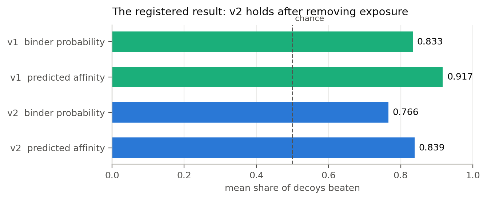
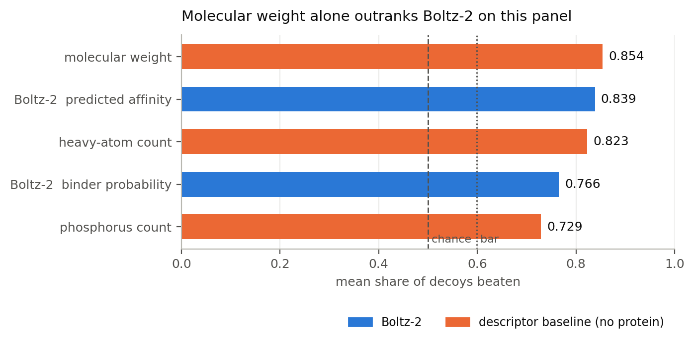
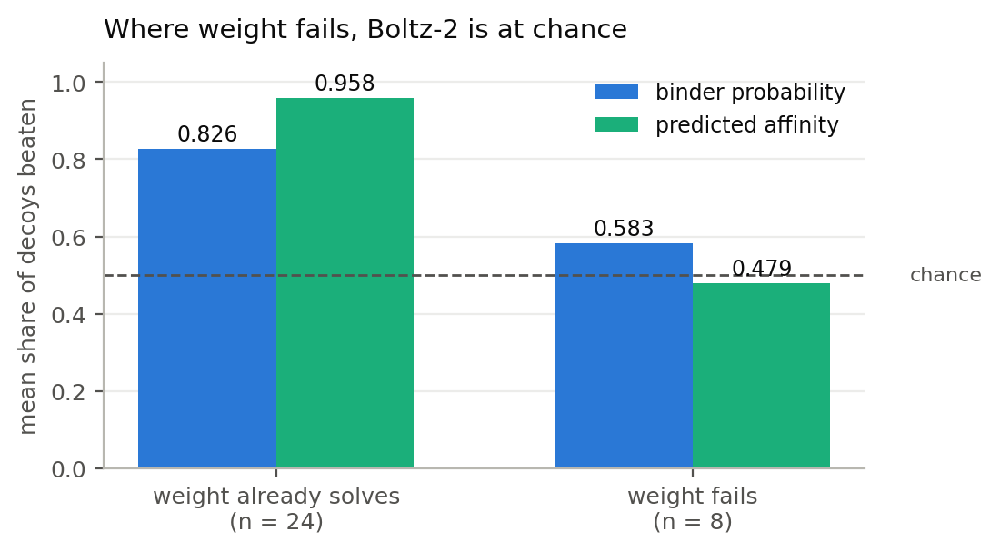
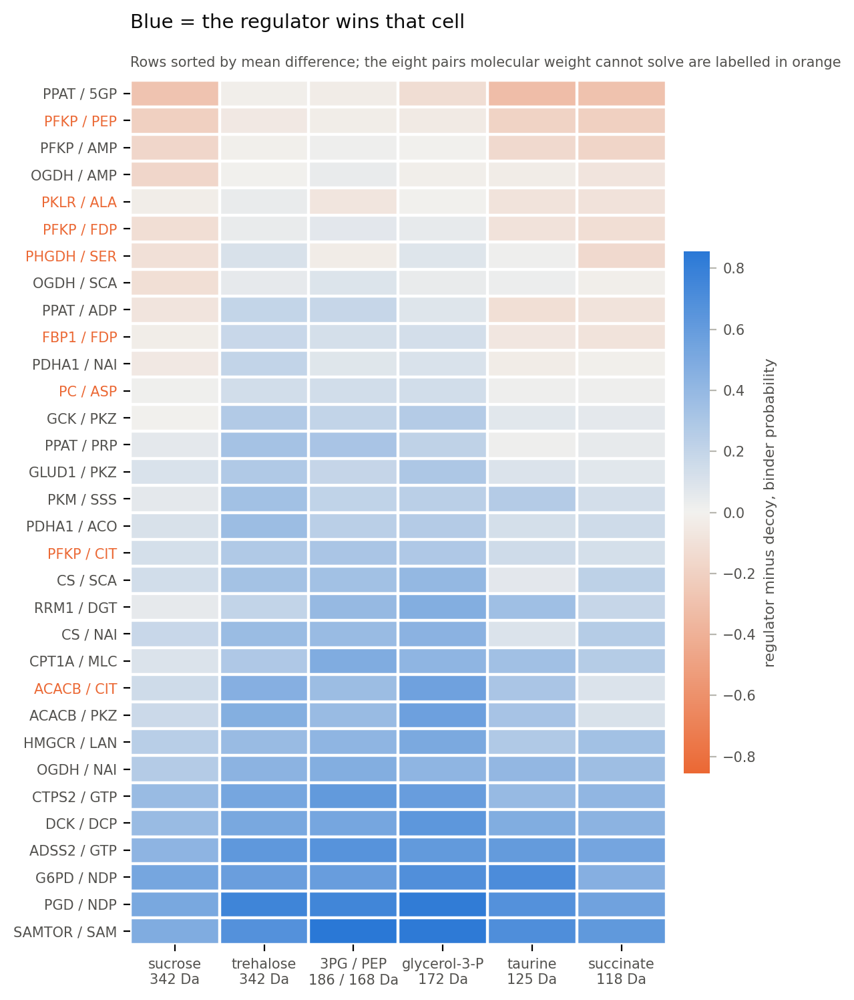
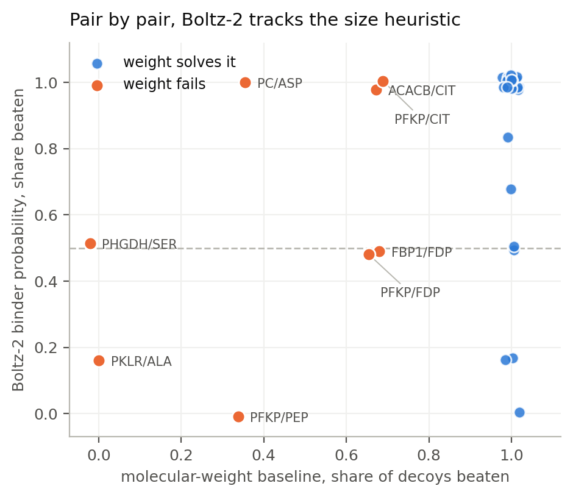
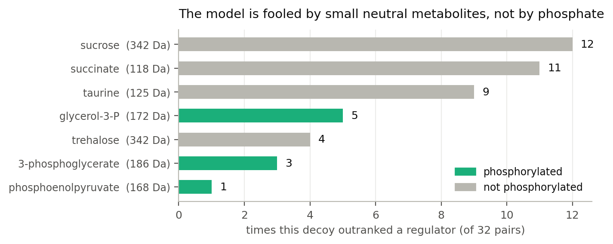
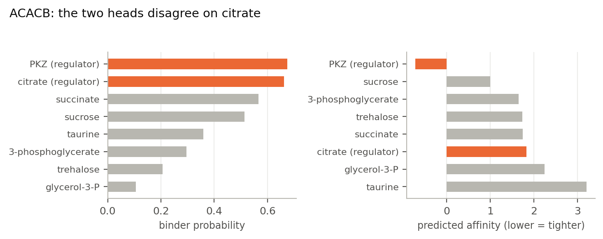

# Molecular weight solves a Boltz-2 benchmark of allosteric metabolite regulation

Javier Villela-Castrejón ^1,2^ and Jason T. George ^1,2,3,\*^

^1^ Department of Biomedical Engineering, Texas A&M University, College Station, TX, USA\
^2^ Department of Translational Medical Sciences, Texas A&M Health Science Center, Houston, TX, USA\
^3^ Department of Hematopoietic Biology and Malignancy, MD Anderson Cancer Center, Houston, TX, USA

\* Correspondence: \[CONFIRM\]

*Draft, 16 November 2026*

## Abstract

Benchmarks of structure-prediction models with affinity heads control for training-set exposure, usually by excluding complexes deposited after a cutoff date. We asked what that control does and does not buy. We benchmarked Boltz-2 on allosteric regulation of human metabolic enzymes, selecting 32 enzyme-metabolite pairs for which the PDB holds no co-structure at any date and neither ChEMBL nor BindingDB holds a binding measurement. Against six decoys per enzyme the regulator was ranked above 0.766 of its decoys by binder probability and 0.839 by predicted affinity, both p < 1e-5 against a uniform-rank null, which is the positive the design was built to produce. Two further checks remove the ground under it. Ranking the same molecules by molecular weight alone, without the protein, scores 0.854; on the 24 pairs weight already solves Boltz-2 scores 0.826, and on the 8 it does not, 0.583, indistinguishable from chance. Separately, a literature audit of the positive class found that 14 of the 32 regulations do not hold as labelled: four are invalid for the human protein or are not regulations at all, three are keyed to the wrong subunit, and seven are mechanism-mislabelled or rest on non-human evidence. Both findings survive the audit; the primary result clears on roughly half its original margin. A disciplined statistic, null and selection rule protect the analysis and neither the decoy panel nor the labels.

## Introduction

Open structure-prediction models now ship affinity heads that score how tightly a ligand binds, and the question of whether those scores reflect learned chemistry or recall of deposited complexes has become the central one for anyone who wants to use them prospectively. The usual answer is a temporal split: hold out structures deposited after the model's training cutoff.

Two facts make that answer incomplete. Boltz-2's structure module trains on PDB entries released before 2023-06-01, so a date-based holdout is defensible there. Its affinity heads carry no stated date cutoff: the regression head trains on PubChem, ChEMBL and BindingDB, and the binary head on PubChem HTS assays, a fragment-screening set and MIDAS, a protein-metabolite interactome. A purely temporal design therefore controls the structure module and leaves the affinity module, frequently the module of interest, uncontrolled. For a benchmark whose positive class is protein-metabolite interaction, the presence of MIDAS in that training mixture is a specific rather than a general concern.

Allosteric regulation of human metabolic enzymes is a useful test bed for a stronger control. The regulation itself is described by decades of kinetics and mutagenesis, while many enzyme-metabolite pairs have never been co-crystallised and have no deposited binding measurement. That makes it possible to select pairs by what the databases hold rather than by when they were deposited. We report below how far that control actually reached in practice, which is less far than the design intended, and that gap is part of the result rather than a footnote to it.

We applied that selection to Boltz-2. An earlier round of the same benchmark, on 12 pairs for which co-structures mostly exist, returned a clear positive which is uninformative for that reason. Here we report the exposure-controlled round, which also returns a clear positive, and then two further checks that remove the ground under it: a descriptor baseline that outscores the model, and an audit of the positive class that finds nearly half of it mislabelled. Neither check was expensive. Together they say more about how a benchmark of this shape should be built, and about what that kind of control does and does not cover, than about Boltz-2.

## Results

### An exposure-controlled panel of 32 regulator pairs

A candidate enzyme-metabolite pair entered the panel only if all four of the following held, each recorded per pair so the panel can be audited rather than trusted: primary literature exists describing the regulation; the PDB holds no structure of the enzyme, or of a homolog above 95% sequence identity, in complex with the metabolite, at any deposition date; neither ChEMBL nor BindingDB holds a binding or inhibition measurement for the pair; and the enzyme is human. Pairs were collected by working through established allosteric and feedback regulation in central carbon, nucleotide and amino-acid metabolism and keeping every pair that passed. No pair was dropped after its prediction was seen.

The first test was run as a PubMed term search with targeted follow-up on every low-scoring survivor, and should be read as "primary literature exists and is on topic" rather than as a verification that each regulation is established specifically by kinetics or mutagenesis. No pair was admitted on folklore, but the 73 candidate papers were not read individually.

The rule yielded 32 regulator pairs across 22 enzymes. Each enzyme received six decoys of fixed construction (two phosphorylated non-nucleotides, two size-matched neutral sugars, two small metabolites, skipping any that is a substrate, product or effector of that enzyme), giving 164 complexes. Each was run as a single-chain protein with one ligand and one diffusion sample on CPU, 152.55 hours in total.

The design fixes the primary and secondary metrics, the statistic, the null and a stopping rule of eight pairs below which the benchmark would not be run. Which pairs enter the panel is the degree of freedom most able to manufacture either result, and it is independent of those choices.

**How far the exposure control reached.** Three limits became apparent during selection and are reported here rather than in the limitations, because they bear directly on what the panel can be read to show.

The structural control (test 2) is strong and behaved as designed: a sequence search at 95% identity against every deposited structure, at any date, keyed on the metabolite as a free ligand. Its four designated positive controls all failed it, as intended.

The deposited-affinity control (test 3) eliminated two pairs on its own. ChEMBL and BindingDB are medicinal-chemistry resources that record drug-like compounds screened against targets, not classical enzymology on endogenous metabolites, which lives in BRENDA and SABIO-RK. Three of the four designated positive controls passed test 3, and inspection confirmed this is a property of the databases rather than of the queries: human GLUD1 is not a ChEMBL target at all, and BindingDB's 2,260 returned ligands for these accessions contain none of the 40 candidate metabolites. As an exposure control for the affinity head, test 3 is therefore nominal.

Sixteen of the 32 pairs are chemically adjacent to an exposed pair. The rule is per-pair and these pass it as written, but for half the panel the same enzyme is co-crystallised with a different candidate metabolite, often a near neighbour at what is plausibly the same site: G6PD passes on NADPH while 17 entries hold NADP+, RRM1 passes on dGTP while dATP, dTTP and ATP are all bound, PPAT passes on GMP, ADP and PRPP while AMP is bound. These pairs are free of exposure to that exact ligand, not of exposure to the site.

### The benchmark passes its primary test

The primary metric is binder probability and the statistic is the mean share of decoys the regulator outranks, tested against a null in which the regulator's rank is uniform among seven. Over the 32 pairs that share was **0.766**, against a critical value of 0.599 at this panel size, with no draw of 100,000 reaching the observed value (p < 1e-5). The regulator ranked first of seven in 20 of 32 pairs. The secondary metric, predicted affinity, gave 0.839 with 19 of 32 first, and held at 0.792 under a margin rule counting a decoy as beaten only where the regulator's lead exceeds 0.234 in log10 IC50.

Against the phosphorylated decoys alone, where the design anticipated the test would be hardest, the shares were 0.859 and 0.891.

Because the 32 pairs are drawn from 22 enzymes, a sensitivity analysis averages within enzyme before averaging across enzymes. It gives 0.831 against a 0.607 critical value, slightly higher than the pair-level figure, because the three enzymes contributing three or four regulators each are among the weakest in the panel.

Taken on its own terms, this is the result the design was built to produce: Boltz-2 ranks known regulators above decoys for pairs to which it has no structural or binding-data exposure.

**Figure 1. The primary result.** Mean share of decoys beaten in the earlier 12-pair round and in the exposure-controlled 32-pair panel, on both metrics. Dashed line, chance. Removing structural and binding-data exposure costs about 0.07 on each metric and leaves both well above the 0.599 critical value. Computed on the panel as published; the same quantities after the label audit are given in the label-set table.

### A descriptor baseline outperforms the model

Nothing in this section alters the primary statistic.

The regulators selected by the four tests above are mostly large phosphorylated nucleotides and cofactors, among them GTP, NADH, NADPH, dGTP, dCTP, GMP, AMP, ADP, SAM, PRPP, acetyl-CoA and succinyl-CoA. The decoys are two disaccharides at 342 Da, succinate at 118 Da, taurine at 125 Da, and three-carbon phosphates between 168 and 186 Da. We therefore ranked the same seven molecules per enzyme by three descriptors computed from the chemical formula alone, without the protein and without the model, and scored each with the identical statistic, the identical 32 pairs and the identical tie convention.

| ranker | mean share of decoys beaten | regulator ranked first |
| --- | --- | --- |
| molecular weight | **0.854** | 24 of 32 |
| Boltz-2, predicted affinity | 0.839 | 19 of 32 |
| heavy-atom count | 0.823 | 21 of 32 |
| Boltz-2, binder probability | 0.766 | 20 of 32 |
| phosphorus count | 0.729 | 20 of 32 |

Molecular weight outranks both Boltz-2 metrics and heavy-atom count outranks the primary one. Neither descriptor has any access to the protein, the binding site or the chemistry of the interaction.

The decoy construction did specify size-matched neutral sugars, and sucrose and trehalose at 342 Da do match a nucleotide monophosphate. What the design did not control is the panel in aggregate. Once nucleotide di- and triphosphates and the CoA thioesters sit on the regulator side, and nothing above 342 Da sits on the decoy side, molecular size separates the two groups unaided.

**Figure 2. Descriptor baselines against Boltz-2.** Same 32 pairs, same statistic. Dashed line, chance; dotted line, the 0.599 critical value. Molecular weight, computed from the chemical formula without the protein, scores highest of the five rankers. Computed on the panel as published; the same quantities after the label audit are given in the label-set table.

### Where molecular weight fails, the model is at chance

A baseline that outscores a model does not establish that the model is uninformative, since the two could succeed on different pairs. We therefore split the panel by whether the weight baseline already ranks the regulator first.

| subset | n | binder probability | predicted affinity |
| --- | --- | --- | --- |
| weight already ranks the regulator first | 24 | 0.826 | 0.958 |
| weight does not | 8 | **0.583** | **0.479** |

On the subset weight does not solve, binder probability gives p = 0.27 against the same uniform-rank null and predicted affinity gives p = 0.60, below chance. Across all 32 pairs the Spearman correlation between the weight baseline and the model's primary metric is 0.35.

Those eight pairs are PHGDH with serine, PKLR with alanine, PC with aspartate, PFKP with phosphoenolpyruvate, ACACB with citrate, PFKP with citrate, FBP1 with fructose-2,6-bisphosphate and PFKP with fructose-2,6-bisphosphate. They are the small-molecule regulators, which are simultaneously the pairs a size heuristic cannot reach and the pairs on which a structure-aware model would be expected to contribute.

At n = 8 the defensible statement is not that the model contributes nothing, but that this panel cannot demonstrate that it contributes, and that its informative subset is too small to decide the question either way.

**Figure 3. The panel split by whether molecular weight already ranks the regulator first.** Where it does (n = 24) both model metrics score well. Where it does not (n = 8) both sit at or below chance. Computed on the panel as published; the same split after the label audit is given in the label-set table.

### The model discriminates chemistry the descriptors cannot

Laying out all 192 comparisons, each regulator against each of its six decoys, as a difference in binder probability (Figure 4) separates the panel's structure from its aggregate. Forty-five of the 192 differences are negative, the same 45 counted above.

The column means run sucrose +0.098, succinate +0.129, taurine +0.169, 3PG or PEP +0.289, trehalose +0.291 and glycerol-3-phosphate +0.310. The hardest decoys to beat lie at both ends of the weight range and the easiest lie in the middle, so the column structure is not a size gradient.

One column pair makes the point sharply. **Sucrose and trehalose are isomers**: the same formula, the same 342 Da, the same heavy-atom count. Every descriptor used in this report scores them identically and has no capacity to separate them. Boltz-2 separates them by 0.19 in mean difference, and sucrose outranks a regulator 12 times against trehalose's 4.

The model therefore uses information to which none of these descriptors has access. The preceding section should not be read as evidence that the model is blind, but as evidence that whatever it sees does not express itself in this panel's aggregate statistic.

**Figure 4. Every comparison in the panel.** Each cell is the regulator's binder probability minus one decoy's, so blue is a win for the regulator and orange a loss. Rows are the 32 pairs sorted by mean difference, columns the six decoys ordered heaviest to lightest; the eight pairs molecular weight cannot solve are labelled in orange. Sucrose and trehalose are isomers and are identical to every descriptor in this report, yet their columns differ by 0.19 in mean difference. Computed on the panel as published.

### Fourteen of the 32 positives do not hold as labelled

We audited the positive class against primary literature, asking of each pair whether a verifiable citation exists and whether the regulation holds for the human protein the panel names. Fourteen of the 32 do not pass.

**Four are invalid.** PHGDH/serine was tested directly in the human enzyme and no inhibition was found; serine feedback through the ACT domain is a property of bacterial type III PGDH, and human PHGDH is type I with the serine-binding residues mutated. PC/aspartate holds for microbial and fungal pyruvate carboxylase, while the vertebrate enzyme is insensitive to aspartate and is inhibited by glutamate. OGDH/AMP is a bacterial and plant property; the animal complex is activated by ADP, phosphate and calcium. And ADSS2/GTP is not a regulation at all: GTP is the phosphoryl donor in the adenylosuccinate synthetase reaction. The panel scored that pair 1.000 on both metrics, so the model ranked a substrate first of seven and the benchmark counted it as evidence of allosteric prediction.

**Three are keyed to the wrong protein.** NADH inhibits both the pyruvate dehydrogenase and 2-oxoglutarate dehydrogenase complexes versus NAD+ at the E3 component, the shared dihydrolipoyl dehydrogenase, not at PDHA1 or at the OGDH E1 subunit. Acetyl-CoA inhibits the PDH complex at the E2 transacetylase site and indirectly through the acetyl-CoA/CoA ratio activating PDH kinase, not at a site on PDHA1. All three therefore ask the model to dock a ligand onto a chain that does not carry its site, which single-chain input makes worse rather than better.

**Seven more are mechanism-mislabelled or rest on non-human evidence.** NADH inhibition of eukaryotic citrate synthase is isosteric competition at the acetyl-CoA site, the allosteric version being specific to Gram-negative bacteria. NADPH inhibition of 6-phosphogluconate dehydrogenase is product inhibition with no human primary paper, and the modern literature reserves NADPH feedback for G6PD. PRPP activation of PPAT is substrate-driven, PRPP being the substrate. No study of palmitoyl-CoA inhibition exists on human ACC2, the classical work being avian and rat and effectively ACC1. Phosphoenolpyruvate is a canonical allosteric inhibitor of bacterial rather than mammalian PFK-1, with one human measurement supporting the pair. Lanosterol acts on HMGCR by Insig-mediated accelerated degradation, not by inhibiting catalysis. And SAMTOR is a SAM-binding sensor upstream of mTORC1, not a metabolic enzyme with an activity to inhibit.

One structural feature of the panel compounds this. There is no classical enzymology on purified human PFKP: the older phosphofructokinase literature is rabbit and rat muscle, which is PFKM, or rat liver, which is PFKL. All four PFKP pairs, an eighth of the panel, rest for isoform-correctness on a single 2020 paper.

### Both findings survive the audit; the primary result narrows

| label set | n | molecular weight | Boltz-2 binder prob. | critical value | weight-fails subset |
| --- | --- | --- | --- | --- | --- |
| as published | 32 | 0.854 | 0.766 | 0.599 | 0.583 (n=8, p 0.27) |
| minus the 4 invalid | 28 | 0.893 | 0.780 | 0.601 | 0.528 (n=6, p 0.46) |
| minus invalid and mis-keyed | 25 | 0.880 | 0.773 | 0.607 | 0.528 (n=6, p 0.46) |
| strict, minus all 14 flagged | 18 | 0.870 | 0.741 | 0.630 | 0.633 (n=5, p 0.22) |

The descriptor baseline outscores the model in every label set, by a wider margin after cleaning than before it. The subset that molecular weight cannot solve remains indistinguishable from chance throughout, at n between 5 and 8.

The primary result is what erodes. As published it clears its critical value by 0.167; under the strictest label set it clears by 0.111 on 18 pairs. It survives, on roughly half the cushion, and a reader who insists on the strict set is entitled to that version.

### Two observations independent of the aggregate

**The failure mode is not the one the design anticipated.** Two of the six decoys per enzyme were chosen as phosphorylated non-nucleotides specifically to test whether the model is misled by phosphate groups. Of the 45 instances in which a decoy outranks its regulator on binder probability, 36, or 80%, involve non-phosphorylated decoys: sucrose 12, succinate 11, taurine 9, trehalose 4 (Supplementary Fig. S2). The earlier 12-pair round found the same pattern in 100% of its failures, on an independent panel.

Succinate and taurine, at 118 and 125 Da the lightest molecules in every panel, account for 20 of the 45 between them, so this is not the size effect in another guise.

**The two metrics agree in aggregate and disagree pair by pair.** ACACB is the clearest case (Supplementary Fig. S3). It contributes two regulators. Palmitoyl-CoA, the feedback inhibitor, ranks first of seven on both metrics, with a lead of +1.72 in log10 IC50 over its nearest decoy. Citrate, the canonical allosteric activator of acetyl-CoA carboxylase, also ranks first of seven on binder probability, and then falls below four of six decoys on predicted affinity, with a lead of -0.83 against the nearest. No pair in this panel should be quoted from one metric alone.

## Discussion

A benchmark built to the standard the field currently argues about, with no co-structure at any deposition date and no deposited measurement, cleared its own significance bar at p < 1e-5. Two cheap checks then removed the ground under it. The first found it is solved by a quantity computable from the chemical formula. The second found that 14 of its 32 positives do not hold as labelled. Neither check required new computation, neither took more than a day, and neither was prevented by the design, because the design covers the statistic, the null and the selection rule and says nothing about what the decoy panel was composed of or about whether the regulations were real.

We expect that asymmetry to recur wherever the positive class is defined by biology and the negative class by convenience. Known allosteric regulators of central metabolism are disproportionately nucleotides and cofactors, because that is what metabolism uses for signalling. Decoys assembled to be chemically unrelated to the target will therefore tend to be smaller, and fixing one decoy panel across all targets makes the resulting size separation systematic rather than incidental. Exposure control does nothing about it, because the problem is not what the model has seen but what the comparison actually tests.

The label failures have a similarly structural cause. Classical metabolic regulation is taught and tabulated as a species-merged canon: a regulation demonstrated in *E. coli*, cauliflower or *Rhizobium* enters review articles, databases and textbooks attached to the pathway rather than to the organism, and is then read back out against a human gene symbol. Four of our invalid pairs are exactly that, and a mini-review we relied on says in its own text that textbook information on one of these enzymes is often inaccurate. A selection test that asks whether primary literature exists, as ours did, cannot catch this, because the literature does exist. It is about a different enzyme.

A corrected design follows from both failures. On the decoy side, decoys should be matched to each regulator on molecular weight and heavy-atom count rather than drawn from a panel shared across targets; the pairs where size cannot separate should be over-sampled rather than left as a residue of eight; descriptor baselines should be reported beside the model; and an isomer pair should be kept in the decoy set deliberately, since two molecules identical to every descriptor give a free internal test of whether the model is using chemistry at all. On the label side, each positive needs a named primary citation that is species-correct, isoform-correct and mechanism-correct, recorded with the pair, and a pair failing any of the three dropped rather than annotated. A screen for the existence of literature is not that test.

Several limits are inherent to the design. Absence from the PDB, ChEMBL and BindingDB bounds deposited data, not the text a model may have been trained on, and these regulatory relationships are widely described in the literature. Two further limits are specific and were established during the work rather than anticipated. First, the deposited-affinity control is nominal: ChEMBL and BindingDB record medicinal chemistry rather than endogenous-metabolite enzymology, which lives in BRENDA and SABIO-RK, and screening those two databases removed two pairs from the panel. Second, Boltz-2's binary affinity head trains in part on MIDAS, a protein-metabolite interactome, which is the same class of measurement as this benchmark's positive examples and was not screened at all. A design that intends to bound affinity-side exposure for metabolites would have to screen the kinetics databases and MIDAS, and that would be a change to the rule rather than a refinement of it.

Sixteen of the 32 pairs are chemically adjacent to an exposed pair: the same enzyme is co-crystallised with a different candidate metabolite, often a close neighbour at what is plausibly the same site, so half the panel is free of exposure to its exact ligand rather than to its site. Single-chain inputs cannot form subunit interfaces. One diffusion sample was used per complex. Pairs lacking a co-structure are plausibly pairs that are harder to study for reasons that also make them harder to predict. Two enzymes, PFKP and CTPS2, differ from the earlier round's PFKL and CTPS1 under the isoform rule, so the comparison in Figure 1 is not quite like for like on those. And the subset that decides the central question is small: eight pairs as published, and five to six after the label audit.

We are not claiming that Boltz-2 fails at this task. That claim would require a panel this one is not, and the separation of sucrose from trehalose argues against it. We are claiming that this benchmark, and plausibly others built the same way, cannot tell the difference between a model that understands allosteric binding and a ruler, and that it could not have told the difference even with perfect labels. The label audit is single-pass: it was run by four parallel literature searches under the verification constraints described in Methods, it has not been independently repeated, and a reader who disputes an individual call can recompute every figure from the deposited per-pair table.

Two practical recommendations follow, and both are cheap. Report a descriptor baseline beside any benchmark of this shape: it costs minutes against days of inference and here it is the only check that would have changed the interpretation. And audit the positive class before running anything, to a standard of species, isoform and mechanism rather than of literature existence: ours took four parallel literature passes over 32 pairs and would have reshaped the panel had it been done first.

The broader point is the one we would want carried forward. A disciplined analysis protects against analytic flexibility and against nothing else. The statistic, the null and the critical value here are all defensible, and none of that bears on whether the comparison is informative, because that question lives in the panel rather than in the analysis. A clean analysis and a p-value below 1e-5 are compatible with a benchmark that a ruler solves and whose positives are half wrong.

## Methods

**Panel selection.** Candidate enzyme-metabolite pairs were collected by working through established allosteric and feedback regulation in central carbon, nucleotide and amino-acid metabolism, applying the four tests in order and keeping every pair that passed. Test 1 was a PubMed term search per pair, with the search string, hit count and top hits recorded, plus targeted follow-up searches on every low-scoring survivor; it establishes that on-topic primary literature exists, not that the regulation is established by kinetics or mutagenesis specifically. Test 2 used the RCSB search API, one query per chemical component so each elimination names its cause, with the protein side a sequence search at 95% identity (any organism, any deposition date) and the ligand side matched as a free non-polymer entity; query date 2026-10-28. Test 3 queried ChEMBL for every target whose components include the enzyme's UniProt accession crossed with every molecule sharing the metabolite's connectivity, and BindingDB by `getLigandsByUniprot`, converting each returned ligand's SMILES to an InChIKey with RDKit and comparing on the skeleton. Test 4 required a reviewed human UniProt entry whose own primary gene name matches. Where a regulation is attributed to a gene family, the isoform with the most PDB entries was used. The benchmark required at least eight pairs; below that it would not be run.

**Decoy construction.** Six decoys per enzyme: two phosphorylated non-nucleotides, two size-matched neutral sugars and two small metabolites, skipping and substituting any molecule that is a substrate, product or effector of that enzyme. In the realised panel these are the PDB chemical component codes 3PG (or PEP where 3PG was excluded), G3P, SUC, TRE, SIN and TAU.

**Prediction.** Boltz-2 2.0.3 with a local fp32 patch, since the released build hard-codes bf16-mixed precision and no bf16 CPU kernels exist; the patch gave roughly an 11-fold speedup and made the run feasible without a GPU. Each complex was a single protein chain from the UniProt canonical sequence plus one ligand specified by CCD code, with the affinity head enabled and one diffusion sample. All 164 complexes completed with no non-zero return codes, in 152.55 hours of wall clock on CPU.

**Statistic.** The primary metric is binder probability (`affinity_probability_binary`) and the secondary is predicted affinity (`affinity_pred_value`, log10 IC50, lower is tighter). For each pair we computed the share of that enzyme's six decoys the regulator outranks, with ties counting as not beaten, and the panel statistic is the mean of those shares. The null draws the regulator's rank uniformly among seven, 100,000 draws at seed 20261023, and p is the share of draws at or above the observed mean. The critical value is the 95th percentile of the same null over 200,000 draws.

**Secondary margin rule.** A decoy counts as beaten only where the regulator's lead exceeds 0.234 in log10 IC50.

**Clustering sensitivity.** Shares were averaged within enzyme and then across the 22 enzymes. Its null draws k ranks for an enzyme contributing k regulators and averages within enzyme before averaging across, reproducing the panel's own composition.

**Descriptor baselines.** Molecular weight, heavy-atom count and phosphorus count were computed from each ligand's CCD formula and ranked highest first, scored with the identical statistic, pairs and tie convention.

**Label audit.** Each of the 32 pairs was checked against primary literature by four parallel literature searches, one per pathway block, each required to return a citation verifiable by PMID or DOI, the species and isoform actually studied, the evidence type, and an explicit NOT FOUND where no citation could be verified rather than a plausible substitute. A pair was recorded as invalid where the regulation is established only outside vertebrates and is absent or contradicted in the human enzyme, or where the ligand is a substrate rather than an effector; as mis-keyed where the binding site lies on a polypeptide other than the one the panel supplied; and as mislabelled where the mechanism differs from the one the panel asserts or where no human, isoform-correct evidence exists. The per-pair table with all citations and flags is Supplementary Table S1. Verification was constrained: NCBI E-utilities, Crossref, Europe PMC REST and Semantic Scholar are blocked from the analysis environment, PubMed, JBC, ScienceDirect and Wiley refuse automated fetches, and PMC responds intermittently, so several records were confirmable only through publisher pages, Wikidata and Scilit entries, institutional repositories or verbatim reference-list entries in accessible articles. Fields that could not be closed are marked as such in the deposited table and should be checked once in a browser before any reference list is final.

**Code.** Before running, the primary analysis script reproduces its critical-value method at six panel sizes (0.722, 0.688, 0.667, 0.653, 0.644 and 0.625 at n = 6, 8, 10, 12, 15 and 20) and refuses to run if any value differs by more than 0.001.

## Data and code availability

The per-pair selection record with its queries and dates, the analysis scripts, the baseline and label-audit outputs, the per-pair label audit table, and the per-complex model outputs (164 affinity and 164 confidence files with predicted structures) are deposited at \[CONFIRM: repository and DOI\]. The deposit is public from the date this preprint is posted. Reproducing the predictions requires Boltz-2 2.0.3 with the fp32 patch described in Methods and approximately 150 CPU hours.

Any further information or material relating to this work is available from the authors on reasonable request.

## Author contributions

J.V.C. designed the benchmark, implemented the pipeline, ran the predictions and the analyses, performed the descriptor baseline and the label audit, produced the figures, and wrote the manuscript. J.T.G. supervised the work and revised the manuscript. *\[CONFIRM: both authors to approve this allocation before posting.\]*

## Competing interests

The authors declare no competing interests. *\[CONFIRM\]*

## Funding

&#91;CONFIRM\]

## References

1. Passaro S, Corso G, Wohlwend J, Reveiz M, Thaler S, Somnath VR, Getz N, Portnoi T, Roy J, Stark H, Kwabi-Addo D, Beaini D, Jaakkola T, Barzilay R. Boltz-2: towards accurate and efficient binding affinity prediction. bioRxiv 2025.06.14.659707 (2025). DOI 10.1101/2025.06.14.659707. Source of the structure-module cutoff (PDB entries released before 2023-06-01), the absence of any stated affinity-data cutoff, and the affinity training sources (regression head: PubChem, ChEMBL, BindingDB; binary head: PubChem HTS, a fragment-screening set, and MIDAS).
2. Yazdani-Jahromi M, Padhi S, Garibay I. MIRAGE: Measuring Interpolation and Redundancy in Affinity GEneralization. arXiv:2609.14491 (2026). DOI 10.48550/arXiv.2609.14491. Source of the family generalisation gap (G\_m about +0.62, bootstrap 95% CI roughly \[+0.13, +1.02\], 373 matched complexes), the finding that Boltz-2 is essentially uncorrelated with affinity for families with fewer than 21 structures, the family-balanced endpoint interval spanning zero, and the MSA-depth effect on novel-family pose success (2% without an MSA, 46% with a ColabFold MSA, against 66% on redundant families).
3. Abramson J, Adler J, Dunger J, et al. Accurate structure prediction of biomolecular interactions with AlphaFold 3. Nature 2024;630(8016):493-500. DOI 10.1038/s41586-024-07487-w. Cited for the 2021-09-30 cutoff convention in AlphaFold3-style splits.
4. Berman HM, Westbrook J, Feng Z, Gilliland G, Bhat TN, Weissig H, Shindyalov IN, Bourne PE. The Protein Data Bank. Nucleic Acids Research 2000;28(1):235-242. DOI 10.1093/nar/28.1.235. Cited for the structural database and the RCSB search API.
5. Zdrazil B, Felix E, Hunter F, et al. The ChEMBL Database in 2023: a drug discovery platform spanning multiple bioactivity data types and time periods. Nucleic Acids Research 2024;52(D1):D1180-D1192. DOI 10.1093/nar/gkad1004.
6. Liu T, Hwang L, Burley SK, Nitsche CI, Southan C, Walters WP, Gilson MK. BindingDB in 2024: a FAIR knowledgebase of protein-small molecule binding data. Nucleic Acids Research 2025;53(D1):D1633-D1644. DOI 10.1093/nar/gkae1075.
7. Hicks KG, Cluntun AA, Schubert HL, et al. Protein-metabolite interactomics of carbohydrate metabolism reveal regulation of lactate dehydrogenase. Science 2023;379(6636):996-1003. DOI 10.1126/science.abm3452. The MIDAS dataset, which appears in Boltz-2's binary affinity training mixture.
8. Chang A, Jeske L, Ulbrich S, Hofmann J, Koblitz J, Schomburg I, Neumann-Schaal M, Jahn D, Schomburg D. BRENDA, the ELIXIR core data resource in 2021: new developments and updates. Nucleic Acids Research 2021;49(D1):D498-D508. DOI 10.1093/nar/gkaa1025. Cited as the repository that does hold endogenous-metabolite enzymology.
9. Wittig U, Rey M, Weidemann A, Kania R, Müller W. SABIO-RK: an updated resource for manually curated biochemical reaction kinetics. Nucleic Acids Research 2018;46(D1):D656-D660. DOI 10.1093/nar/gkx1065. As above.
10. RDKit: open-source cheminformatics, release 2026.09.1. https://www.rdkit.org. Used for SMILES to InChIKey conversion in the BindingDB arm.

### Sources cited in the label audit

Verified to the standard described in Methods. Each entry was confirmed against its MEDLINE record through Europe PMC on 16 November 2026, with PMIDs and DOIs as given.

- Murtas G, Marcone GL, Peracchi A, Zangelmi E, Pollegioni L. Biochemical and biophysical characterization of recombinant human 3-phosphoglycerate dehydrogenase. Int J Mol Sci 2021;22(8):4231. DOI 10.3390/ijms22084231. *(PHGDH: serine inhibition tested and absent in the human enzyme.)*
- Zeczycki TN, St. Maurice M, Attwood PV. Inhibitors of pyruvate carboxylase. Open Enzyme Inhib J 2010;3:8-26. DOI 10.2174/1874940201003010008. *(Aspartate inhibition is microbial and fungal; vertebrate PC is insensitive.)*
- Strumilo S. Short-term regulation of the alpha-ketoglutarate dehydrogenase complex by energy-linked and some other effectors. Biochemistry (Moscow) 2005;70(7):726-729. PMID 16097935. *(AMP activation is bacterial and plant; the animal complex responds to ADP, Pi and Ca2+.)*
- Harford S, Weitzman PDJ. Evidence of isosteric and allosteric nucleotide inhibition of citrate synthase from multiple-inhibition studies. Biochem J 1975;151(2):455-458. PMID 175782. DOI 10.1042/bj1510455. *(The eukaryotic enzyme studied is pig heart; NADH is isosteric in eukaryotic and Gram-positive enzymes and allosteric only in the Gram-negative one.)*
- Song BL, Javitt NB, DeBose-Boyd RA. Insig-mediated degradation of HMG CoA reductase stimulated by lanosterol. Cell Metab 2005;1(3):179-189. PMID 16054061.
- Gu X, Orozco JM, Saxton RA, et al. SAMTOR is an S-adenosylmethionine sensor for the mTORC1 pathway. Science 2017;358(6364):813-818. PMID 29123071.
- Fernandes PM, Kinkead J, McNae I, Michels PAM, Walkinshaw MD. Biochemical and transcript level differences between the three human phosphofructokinases show optimisation of each isoform for specific metabolic niches. Biochem J 2020;477(22):4425-4441. PMID 33141153. *(The only isoform-correct source for all four PFKP pairs.)*
- Locke GA, Cheng D, Witmer MR, et al. Differential activation of recombinant human acetyl-CoA carboxylases 1 and 2 by citrate. Arch Biochem Biophys 2008;475(1):72-79. PMID 18455495.
- Caskey CT, Ashton DM, Wyngaarden JB. The enzymology of feedback inhibition of glutamine phosphoribosylpyrophosphate amidotransferase by purine ribonucleotides. J Biol Chem 1964;239(8):2570-2579. PMID 14235537. Holmes EW, McDonald JA, McCord JM, Wyngaarden JB, Kelley WN. Human glutamine phosphoribosylpyrophosphate amidotransferase. Kinetic and regulatory properties. J Biol Chem 1973;248(1):144-150. PMID 4348202.
- Luzzatto L. Regulation of the activity of glucose-6-phosphate dehydrogenase by NADP+ and NADPH. Biochim Biophys Acta 1967;146(1):18-25. PMID 4383500.
- Levitzki A, Koshland DE Jr. Role of an allosteric effector: guanosine triphosphate activation in cytosine triphosphate synthetase. Biochemistry 1972;11(2):241-246. PMID 4550559. Kassel KM, Au DR, Higgins MJ, Hines M, Graves LM. Regulation of human cytidine triphosphate synthetase 2 by phosphorylation. J Biol Chem 2010;285(44):33727-33736. PMID 20739275. *(Reports the kinetics of the human CTPS isozymes, including activity at physiological GTP; the GTP activation constants in the deposited audit table are quoted from a review and are marked there as secondhand.)*
- Eriksson S, Thelander L, Akerman M. Allosteric regulation of calf thymus ribonucleoside diphosphate reductase. Biochemistry 1979;18(14):2948-2952. PMID 223624.
- Keller KE, Tan IS, Lee YS. SAICAR stimulates pyruvate kinase isoform M2 and promotes cancer cell survival in glucose-limited conditions. Science 2012;338(6110):1069-1072. PMID 23086999.
- Kiselevsky YV, Ostrovtsova SA, Strumilo SA. Kinetic characterization of the pyruvate and oxoglutarate dehydrogenase complexes from human heart. Acta Biochim Pol 1990;37(1):135-139. PMID 2087902.

**The full per-pair audit** is Supplementary Table S1 below, with the verdict, the best citation and the species and isoform actually studied for all 32 pairs. Sixteen further primary citations supporting the pairs that hold are listed there rather than here.

\newpage

# Supplementary information

## Supplementary figures

**S1.** Per-pair relationship between the molecular-weight baseline and binder probability, all 32 pairs, with the eight that weight cannot solve labelled.

**S2.** Decoys ranked by how often each outranked a regulator on binder probability, split by whether the decoy is phosphorylated.

**S3.** ACACB on both metrics, all seven ligands.

\newpage

## Supplementary tables

### Table S1. Label audit of the 32 pairs

Each of the 32 pairs was checked against primary literature to answer two questions: does a
verifiable citation exist, and does the regulation hold for the human protein named in the panel. Done by
four parallel literature agents, one per pathway block. Every citation below was verified against at least
one renderable bibliographic source; nothing was reconstructed from memory, and pairs with no verifiable
primary source are recorded as NOT FOUND rather than given a plausible reference.

**Outcome: 14 of 32 pairs carry a flag.** Four are invalid, three are keyed to the wrong protein, seven are
mechanism-mislabelled or rest on thin evidence.

**A.** Invalid: the regulation does not hold for the human protein, or is not a regulation (4)

| pair | finding | source |
|---|---|---|
| PHGDH / serine | Directly tested and absent in human. Serine feedback via the ACT domain is a bacterial type III PGDH property; human PHGDH is type I with the serine-binding residues mutated. | Murtas et al. 2021 Int J Mol Sci 22:4231 (tested directly, no inhibition); Unterlass et al. 2017 Oncotarget; Riva et al. 2024 Protein Sci |
| PC / aspartate | Aspartate inhibits microbial and fungal PC. Vertebrate PC is insensitive and is inhibited by glutamate instead. | Zeczycki, St. Maurice & Attwood 2010; Adina-Zada et al. 2012. Nearest primary is Rhizobium etli (Sirithanakorn et al. 2014) |
| OGDH / AMP | AMP activation is bacterial and plant. The animal complex is activated by ADP, Pi and Ca2+. | Strumilo 2005 Biochemistry (Moscow) 70:726. Nearest primary is cauliflower (Wedding & Black 1971) |
| ADSS2 / GTP | GTP is a substrate of adenylosuccinate synthetase (IMP + Asp + GTP to adenylosuccinate + GDP + Pi), not an effector. The panel scored this pair 1.000 on both metrics. | Reaction stoichiometry; Van der Weyden & Kelley 1974 characterises the human placental activity but predates isoform cloning |

**B.** Keyed to the wrong protein (3)

All three ask the model to dock a ligand onto a subunit that does not carry its site, which single-chain
input makes worse.

| pair | where the site actually is |
|---|---|
| PDHA1 / NADH | NADH inhibits versus NAD+ at the E3 component, the shared dihydrolipoyl dehydrogenase DLD (P09622), not PDHA1 |
| OGDH / NADH | Same: E3 / DLD, not the OGDH E1 subunit |
| PDHA1 / acetyl-CoA | Product inhibition at the E2 transacetylase site competing with CoA, plus indirect action through the acetyl-CoA/CoA ratio activating PDH kinase, which phosphorylates PDHA1. Not a direct allosteric site on P08559 |

**C.** Mechanism mislabelled, or evidence thin (7)

| pair | finding |
|---|---|
| CS / NADH | In eukaryotic enzymes NADH competes at the acetyl-CoA site (isosteric). Genuinely allosteric NADH inhibition is specific to Gram-negative bacteria. Harford & Weitzman 1975 (pig heart against Bacillus megaterium and Pseudomonas aeruginosa) |
| PGD / NADPH | Product inhibition, not established allosteric feedback. No human primary paper found; the modern 6PGD literature reserves NADPH feedback for G6PD |
| PPAT / PRPP | PRPP is the substrate, so this is substrate-driven reversal of nucleotide inhibition, not heterotropic activation. Holmes, Wyngaarden & Kelley 1973 JBC 248:6035 |
| ACACB / palmitoyl-CoA | No study on purified or recombinant human ACC2. Classical work is avian (Goodridge 1972) and rat adipose (Halestrap & Denton 1974), both effectively ACC1 |
| PFKP / phosphoenolpyruvate | PEP is a canonical allosteric inhibitor of bacterial PFK-1, not mammalian. The only human evidence is one 2020 measurement (Fernandes et al., ATP specificity constant down 40%) |
| HMGCR / lanosterol | Insig-mediated sterol-accelerated degradation through the sterol-sensing domain, not allosteric inhibition of catalysis. Song, Javitt & DeBose-Boyd 2005 Cell Metab 1:179 |
| SAMTOR / S-adenosylmethionine | SAMTOR is a SAM-binding sensor upstream of mTORC1, not a metabolic enzyme with a catalytic activity to inhibit. Gu et al. 2017 Science 358:813 |

**D.** The 18 that hold, with their best citation

| pair | citation | species / isoform note |
|---|---|---|
| PFKP / citrate | Fernandes et al. 2020 Biochem J 477:4425 (IC50 177 uM) | human PFKP. Classical work (Garland, Randle & Newsholme 1963; Pogson & Randle 1966) is rat heart PFKM |
| PFKP / fructose-2,6-bisphosphate | Fernandes et al. 2020 (AC50 9.13 uM) | human PFKP. Effector discovered on rat liver PFKL (Van Schaftingen, Hue & Hers 1980) |
| PFKP / AMP | Fernandes et al. 2020 (ATP specificity +220%) | human PFKP. Classical attribution (Passonneau & Lowry 1962) is textbook-level with no single establishing paper |
| GCK / palmitoyl-CoA | Dawson CM & Hales CN 1969 BBA 176:657 (PMID 5800058, DOI 10.1016/0005-2760(69)90238-0); Tippett & Neet 1982 JBC 257:12839 | rat liver |
| PKM / SAICAR | Keller, Tan & Lee 2012 Science 338:1069 | human, PKM2-specific |
| PKLR / alanine | Fenton & Hutchinson 2009 ABB 484:16; Llorente, Marco & Sols 1970 EJB 13:45 | human recombinant liver PK; classical is rat |
| FBP1 / fructose-2,6-bisphosphate | Van Schaftingen & Hers 1981 PNAS 78:2861 (PMID 6265919, DOI 10.1073/pnas.78.5.2861); co-discovered independently by Pilkis et al. 1981 JBC 256:3619 (PMID 6260770) | rat liver |
| CS / succinyl-CoA | Smith & Williamson 1971 FEBS Lett 18:35 | bovine heart (species assignment secondhand) |
| OGDH / succinyl-CoA | Kiselevsky, Ostrovtsova & Strumilo 1990 Acta Biochim Pol 37:135 (Ki about 81 uM) | human heart complex, not isolated E1 |
| G6PD / NADPH | Luzzatto 1967 BBA 146:18 | human erythrocyte |
| PPAT / GMP | Caskey, Ashton & Wyngaarden 1964 JBC 239:2570; Holmes et al. 1973 JBC 248:144 | pigeon liver; human enzyme. Two-site mechanism, 6-oxopurine site |
| PPAT / ADP | same two papers | 6-aminopurine site |
| CTPS2 / GTP | Levitzki & Koshland 1972 Biochemistry 11:241; Kassel et al. 2010 JBC 285:33727 | E. coli; human CTPS2-specific |
| RRM1 / dGTP | Eriksson, Thelander & Akerman 1979 Biochemistry 18:2948 | calf thymus. Correctly the specificity site on R1, not the activity site |
| DCK / dCTP | Kim & Ives 1989 Biochemistry 28:9043 | human. End-product inhibition at the active site rather than a separate allosteric site |
| GLUD1 / palmitoyl-CoA | Kawaguchi & Bloch 1976 JBC 251:1406 | mammalian liver GDH. The one explicitly human paper (Son et al. 2012) used GLUD2, not GLUD1 |
| ACACB / citrate | Locke et al. 2008 ABB 475:72 | human recombinant ACC2, isoform-resolved against ACC1 (>1000-fold vs about 4-fold) |
| CPT1A / malonyl-CoA | McGarry, Mannaerts & Foster 1977 J Clin Invest 60:265 | rat liver |

**E.** Effect on the result

| label set | n | MW baseline | Boltz-2 binder prob. | critical value | hard subset |
|---|---|---|---|---|---|
| as published | 32 | 0.854 | 0.766 | 0.599 | 0.583 (n=8, p 0.27) |
| minus 4 invalid | 28 | 0.893 | 0.780 | 0.601 | 0.528 (n=6, p 0.46) |
| minus invalid and mis-keyed | 25 | 0.880 | 0.773 | 0.607 | 0.528 (n=6, p 0.46) |
| strict, minus all 14 | 18 | 0.870 | 0.741 | 0.630 | 0.633 (n=5, p 0.22) |

The central finding is unaffected: the molecular-weight baseline outranks Boltz-2's binder probability in
every label set, by a wider margin after cleaning. The decomposition is unaffected: the subset weight cannot
solve stays indistinguishable from chance throughout.

The primary result narrows. Published it is 0.766 against a 0.599 bar; under the strictest label set it
is 0.741 against 0.630. It still clears, on roughly half the cushion.

**F.** Verification limits

NCBI E-utilities, Crossref API, Europe PMC REST and Semantic Scholar are blocked at the egress proxy
used for the analysis, and pubmed.ncbi.nlm.nih.gov, jbc.org, sciencedirect.com and wiley.com refuse
automated fetches, so the citations below were first confirmed through publisher pages, Wikidata and
Scilit records, institutional repositories, and verbatim reference-list entries in accessible PMC
articles, each cross-checked against at least one independent source.

The fields left open by that pass were closed on 16 November 2026 against MEDLINE records read
through Europe PMC in a browser: Holmes et al. 1973 is PMID 4348202, Van der Weyden & Kelley 1974 is
PMID 4436310 (indexed with the second author as Kelly), and Kassel et al. 2010 is PMID 20739275 with
DOI 10.1074/jbc.M110.178566. The eukaryotic citrate synthase in Harford & Weitzman 1975 is pig heart,
and Van Schaftingen & Hers 1981 is rat liver, both from the MeSH records. Dawson & Hales 1969 carries
DOI 10.1016/0005-2760(69)90238-0. The Pilkis et al. 1981 co-discovery of fructose-2,6-bisphosphate
inhibition of FBP1 was confirmed directly (JBC 256:3619-3622, PMID 6260770) rather than through a
review's attribution.

Two fields remain open and are not used in the manuscript: the species in Bremer 1969, whose
citation in the per-pair table does not resolve to a unique 1969 record, and the content of
Garland 1964 as distinct from Garland, Randle & Newsholme 1963.

The GTP activation constants attributed to Kassel et al. 2010 in this table are quoted from a review
and were not read from the paper itself; the paper reports the kinetics of the human CTPS isozymes
including activity at physiological GTP.

\newpage

\begin{landscape}
\subsubsection*{Table S2. Candidate screen, all 73 enzyme-metabolite pairs}
Every pair collected, with its result on each of the four tests described in Methods and the resulting verdict. Test 1, on-topic primary literature, reports the PubMed hit count. Test 2, absence of a co-structure, reports the PDB chemical component codes found and their entry counts, so each elimination names its cause. Test 3 is absence of a binding measurement in ChEMBL and BindingDB. Test 4 requires a reviewed human UniProt entry whose primary gene name matches. A pair enters the panel only by passing all four.
\vspace{0.6em}
\footnotesize
\begin{longtable}{@{}>{\raggedright\arraybackslash}p{0.025\linewidth}>{\raggedright\arraybackslash}p{0.105\linewidth}>{\raggedright\arraybackslash}p{0.085\linewidth}>{\raggedright\arraybackslash}p{0.145\linewidth}>{\raggedright\arraybackslash}p{0.085\linewidth}>{\raggedright\arraybackslash}p{0.175\linewidth}>{\raggedright\arraybackslash}p{0.135\linewidth}>{\raggedright\arraybackslash}p{0.055\linewidth}>{\raggedright\arraybackslash}p{0.075\linewidth}@{}}
\toprule
\# & enzyme (gene field) & resolved & regulator & T1 lit (PubMed n) & T2 co-structure & T3 affinity & T4 human & verdict \\
\midrule
\endfirsthead
\toprule
\# & enzyme (gene field) & resolved & regulator & T1 lit (PubMed n) & T2 co-structure & T3 affinity & T4 human & verdict \\
\midrule
\endhead
1 & PFKL / PFKM / PFKP & PFKP (Q01813) & ATP & PASS (38) & FAIL (2: ATP:2) & PASS & PASS & excluded \\
2 & PFKL / PFKM / PFKP & PFKP (Q01813) & citrate & PASS (6) & PASS (0) & PASS & PASS & \textbf{IN PANEL} \\
3 & PFKL / PFKM / PFKP & PFKP (Q01813) & fructose-2,6-bisphosphate & PASS (5) & PASS (0) & PASS & PASS & \textbf{IN PANEL} \\
4 & PFKL / PFKM / PFKP & PFKP (Q01813) & AMP & PASS (5) & PASS (0) & PASS & PASS & \textbf{IN PANEL} \\
5 & PFKL / PFKM / PFKP & PFKP (Q01813) & phosphoenolpyruvate & PASS (2) & PASS (0) & PASS & PASS & \textbf{IN PANEL} \\
6 & HK1 / HK2 & HK1 (P19367) & glucose-6-phosphate & PASS (43) & FAIL (5: BG6:1, G6P:3, M6D:1) & PASS & PASS & excluded \\
7 & GCK & GCK (P35557) & fructose-6-phosphate & PASS (71) & FAIL (1: F6P:1) & PASS & PASS & excluded \\
8 & GCK & GCK (P35557) & palmitoyl-CoA & PASS (16) & PASS (0) & PASS & PASS & \textbf{IN PANEL} \\
9 & PKM & PKM (P14618) & fructose-1,6-bisphosphate & PASS (9) & FAIL (35: FBP:35) & FAIL (ChEMBL 9, BindingDB 0) & PASS & excluded \\
10 & PKM & PKM (P14618) & serine & PASS (50) & FAIL (6: SER:6) & FAIL (ChEMBL 1, BindingDB 0) & PASS & excluded \\
11 & PKM & PKM (P14618) & alanine & PASS (13) & FAIL (1: ALA:1) & FAIL (ChEMBL 1, BindingDB 0) & PASS & excluded \\
12 & PKM & PKM (P14618) & phenylalanine & PASS (5) & FAIL (3: PHE:3) & FAIL (ChEMBL 4, BindingDB 0) & PASS & excluded \\
13 & PKM & PKM (P14618) & SAICAR & screen 0 (0) & PASS (0) & PASS & PASS & \textbf{IN PANEL} \\
14 & PKLR & PKLR (P30613) & fructose-1,6-bisphosphate & PASS (4) & FAIL (13: AFP:1, FBP:12) & PASS & PASS & excluded \\
15 & PKLR & PKLR (P30613) & alanine & PASS (8) & PASS (0) & PASS & PASS & \textbf{IN PANEL} \\
16 & PDHA1 & PDHA1 (P08559) & acetyl-CoA & PASS (36) & PASS (0) & PASS & PASS & \textbf{IN PANEL} \\
17 & PDHA1 & PDHA1 (P08559) & NADH & PASS (5) & PASS (0) & PASS & PASS & \textbf{IN PANEL} \\
18 & FBP1 & FBP1 (P09467) & AMP & PASS (36) & FAIL (6: AMP:6) & FAIL (ChEMBL 13, BindingDB 0) & PASS & excluded \\
19 & FBP1 & FBP1 (P09467) & fructose-2,6-bisphosphate & PASS (7) & PASS (0) & PASS & PASS & \textbf{IN PANEL} \\
20 & PC & PC (P11498) & acetyl-CoA & PASS (108) & FAIL (3: ACO:3) & PASS & PASS & excluded \\
21 & PC & PC (P11498) & aspartate & PASS (213) & PASS (0) & PASS & PASS & \textbf{IN PANEL} \\
22 & CS & CS (O75390) & NADH & PASS (87) & PASS (0) & PASS & PASS & \textbf{IN PANEL} \\
23 & CS & CS (O75390) & succinyl-CoA & PASS (7) & PASS (0) & PASS & PASS & \textbf{IN PANEL} \\
24 & IDH3A & IDH3A (P50213) & ADP & screen 0 (0) & FAIL (4: ADP:4) & PASS & PASS & excluded \\
25 & IDH3A & IDH3A (P50213) & ATP & PASS (9) & FAIL (2: ATP:2) & PASS & PASS & excluded \\
26 & IDH3A & IDH3A (P50213) & NADH & PASS (4) & FAIL (2: NAI:2) & PASS & PASS & excluded \\
27 & OGDH & OGDH (Q02218) & succinyl-CoA & PASS (46) & PASS (0) & PASS & PASS & \textbf{IN PANEL} \\
28 & OGDH & OGDH (Q02218) & NADH & PASS (110) & PASS (0) & PASS & PASS & \textbf{IN PANEL} \\
29 & OGDH & OGDH (Q02218) & AMP & PASS (16) & PASS (0) & PASS & PASS & \textbf{IN PANEL} \\
30 & SDHA & SDHA (P31040) & oxaloacetate & PASS (2) & FAIL (3: OAA:3) & PASS & PASS & excluded \\
31 & G6PD & G6PD (P11413) & NADPH & PASS (496) & PASS (0) & PASS & PASS & \textbf{IN PANEL} \\
32 & G6PD & G6PD (P11413) & NADP+ & PASS (210) & FAIL (17: NAP:17) & PASS & PASS & excluded \\
33 & PGD & PGD (P52209) & NADPH & PASS (37) & PASS (0) & PASS & PASS & \textbf{IN PANEL} \\
34 & PPAT & PPAT (Q06203) & AMP & PASS (30) & FAIL (1: AMP:1) & PASS & PASS & excluded \\
35 & PPAT & PPAT (Q06203) & GMP & PASS (25) & PASS (0) & PASS & PASS & \textbf{IN PANEL} \\
36 & PPAT & PPAT (Q06203) & ADP & PASS (13) & PASS (0) & PASS & PASS & \textbf{IN PANEL} \\
37 & PPAT & PPAT (Q06203) & PRPP & PASS (47) & PASS (0) & PASS & PASS & \textbf{IN PANEL} \\
38 & PRPS1 & PRPS1 (P60891) & ADP & PASS (7) & FAIL (4: ADP:4) & PASS & PASS & excluded \\
39 & PRPS1 & PRPS1 (P60891) & GDP & PASS (4) & FAIL (1: GDP:1) & PASS & PASS & excluded \\
40 & PRPS1 & PRPS1 (P60891) & phosphate & PASS (34) & FAIL (12: PO4:12) & PASS & PASS & excluded \\
41 & IMPDH1 / IMPDH2 & IMPDH2 (P12268) & GTP & PASS (44) & FAIL (9: GTP:9) & PASS & PASS & excluded \\
42 & IMPDH1 / IMPDH2 & IMPDH2 (P12268) & ATP & PASS (5) & FAIL (11: ATP:11) & PASS & PASS & excluded \\
43 & ADSS2 & ADSS2 (P30520) & GTP & screen 0 (0) & PASS (0) & PASS & PASS & \textbf{IN PANEL} \\
44 & CAD & CAD (P27708) & UTP & PASS (18) & PASS (0) & FAIL (ChEMBL 1, BindingDB 0) & PASS & excluded \\
45 & CAD & CAD (P27708) & PRPP & PASS (9) & PASS (0) & FAIL (ChEMBL 1, BindingDB 0) & PASS & excluded \\
46 & CTPS1 / CTPS2 & CTPS2 (Q9NRF8) & CTP & PASS (21) & FAIL (2: CTP:2) & PASS & PASS & excluded \\
47 & CTPS1 / CTPS2 & CTPS2 (Q9NRF8) & GTP & screen 0 (0) & PASS (0) & PASS & PASS & \textbf{IN PANEL} \\
48 & RRM1 & RRM1 (P23921) & dATP & PASS (7) & FAIL (3: DTP:3) & PASS & PASS & excluded \\
49 & RRM1 & RRM1 (P23921) & ATP & PASS (11) & FAIL (1: ATP:1) & PASS & PASS & excluded \\
50 & RRM1 & RRM1 (P23921) & dGTP & PASS (2) & PASS (0) & PASS & PASS & \textbf{IN PANEL} \\
51 & RRM1 & RRM1 (P23921) & dTTP & PASS (2) & FAIL (9: TTP:9) & PASS & PASS & excluded \\
52 & TK1 & TK1 (P04183) & dTTP & PASS (21) & FAIL (3: TTP:3) & PASS & PASS & excluded \\
53 & DCK & DCK (P27707) & dCTP & PASS (77) & PASS (0) & PASS & PASS & \textbf{IN PANEL} \\
54 & PHGDH & PHGDH (O43175) & serine & PASS (447) & PASS (0) & PASS & PASS & \textbf{IN PANEL} \\
55 & GLS & GLS (O94925) & phosphate & PASS (64) & FAIL (5: PO4:5) & PASS & PASS & excluded \\
56 & GLS & GLS (O94925) & glutamate & PASS (216) & FAIL (4: GLU:4) & FAIL (ChEMBL 1, BindingDB 0) & PASS & excluded \\
57 & GLUD1 & GLUD1 (P00367) & GTP & PASS (29) & FAIL (12: GTP:12) & PASS & PASS & excluded \\
58 & GLUD1 & GLUD1 (P00367) & ADP & PASS (23) & FAIL (5: ADP:5) & PASS & PASS & excluded \\
59 & GLUD1 & GLUD1 (P00367) & leucine & PASS (25) & FAIL (1: LEU:1) & PASS & PASS & excluded \\
60 & GLUD1 & GLUD1 (P00367) & palmitoyl-CoA & PASS (1) & PASS (0) & PASS & PASS & \textbf{IN PANEL} \\
61 & CBS & CBS (P35520) & S-adenosylmethionine & PASS (208) & FAIL (2: SAM:2) & PASS & PASS & excluded \\
62 & MAT2A & MAT2A (P31153) & S-adenosylmethionine & PASS (203) & FAIL (38: SAM:38) & PASS & PASS & excluded \\
63 & ACACA / ACACB & ACACB (O00763) & citrate & PASS (7) & PASS (0) & PASS & PASS & \textbf{IN PANEL} \\
64 & ACACA / ACACB & ACACB (O00763) & palmitoyl-CoA & PASS (6) & PASS (0) & PASS & PASS & \textbf{IN PANEL} \\
65 & CPT1A & CPT1A (P50416) & malonyl-CoA & PASS (38) & PASS (0) & PASS & PASS & \textbf{IN PANEL} \\
66 & HMGCR & HMGCR (P04035) & sterol / lanosterol & PASS (717) & PASS (0) & PASS & PASS & \textbf{IN PANEL} \\
67 & CPS1 & CPS1 (P31327) & N-acetylglutamate & PASS (38) & FAIL (1: NLG:1) & PASS & PASS & excluded \\
68 & PRKAG1 / PRKAG2 & PRKAG1 (P54619) & AMP & PASS (18) & FAIL (40: AMP:40) & FAIL (ChEMBL 13, BindingDB 0) & PASS & excluded \\
69 & PRKAG1 / PRKAG2 & PRKAG1 (P54619) & ADP & PASS (1) & FAIL (13: ADP:13) & PASS & PASS & excluded \\
70 & PRKAG1 / PRKAG2 & PRKAG1 (P54619) & ATP & PASS (6) & FAIL (9: ATP:9) & PASS & PASS & excluded \\
71 & SESN2 & SESN2 (P58004) & leucine & PASS (12) & FAIL (3: LEU:3) & PASS & PASS & excluded \\
72 & CASTOR1 & CASTOR1 (Q8WTX7) & arginine & PASS (35) & FAIL (5: ARG:5) & PASS & PASS & excluded \\
73 & SAMTOR & SAMTOR (Q1RMZ1) & S-adenosylmethionine & PASS (15) & PASS (0) & PASS & PASS & \textbf{IN PANEL} \\
\bottomrule
\end{longtable}
\end{landscape}
